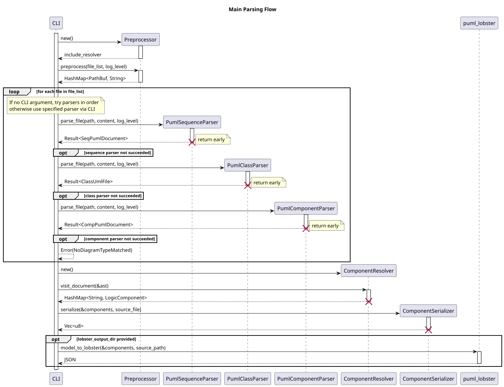
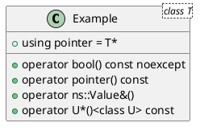
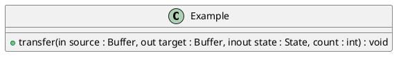
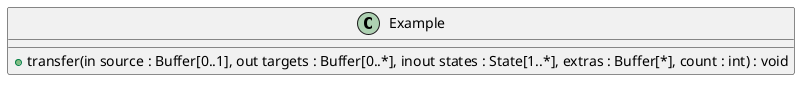
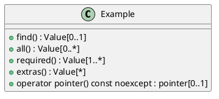
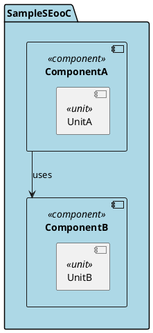
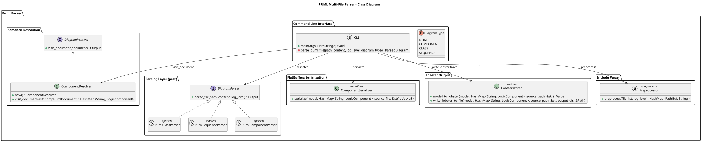
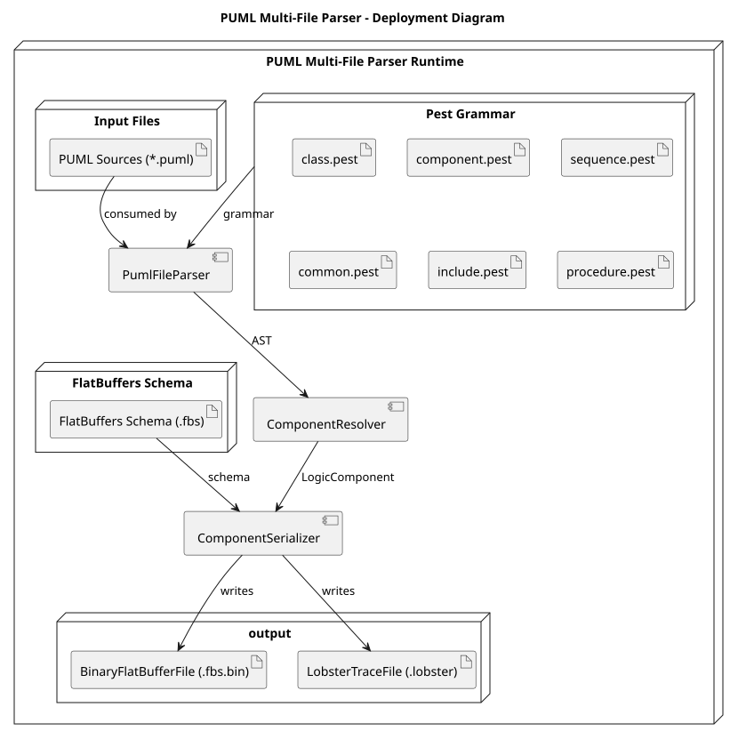
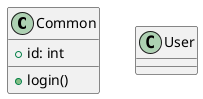

<!-- ----------------------------------------------------------------------------
  Copyright (c) 2026 Contributors to the Eclipse Foundation

  See the NOTICE file(s) distributed with this work for additional
  information regarding copyright ownership.

  This program and the accompanying materials are made available under the
  terms of the Apache License Version 2.0 which is available at
  https://www.apache.org/licenses/LICENSE-2.0

  SPDX-License-Identifier: Apache-2.0
----------------------------------------------------------------------------- -->
# PlantUML Parser

### Processing Phases

The sequence diagram shows the phases of the plantuml processing:



#### 1. Preprocessing Phase

`!include` directives are expanded into a single self-contained `.puml` content per file before any parsing occurs. The supported directives are:

- `!include`
- `!include_once`
- `!include_many`
- `!includesub`

The preprocessor:

- Resolves a path relative to the directory of the file holding the directive, as PlantUML does; an absolute path is accepted only for an available file
- Accepts only the `--include-file` files of the run (see [`README.md`](../README.md)), never a diagram of the run; an include file needs no `@startuml` and is never parsed as a diagram
- Recursively expands nested includes
- Detects circular dependencies and reports an error
- Caches already-resolved files to avoid redundant I/O
- Records the file and line of every expanded line, so source locations and parse errors name the included file and its own line; a diagram that defines `!procedure`s keeps the line of the fully expanded text instead, with a warning
- Reports an unresolved path with the directive's file and line, and with the relative path of an available file of the same path suffix

#### 2. Parsing Phase

Each preprocessed file is parsed into an AST based on its diagram type. The diagram type is either:

- Specified explicitly via `--diagram-type` CLI argument
- Auto-detected by trying parsers in order (Sequence → Class → Component) until one succeeds
- If all parsers fail, the error with the longest match is reported

##### Conversion operators

Class operations support conversion to builtin, alias, qualified/template and
pointer/reference types, including member-template conversions:



`pointer` aliases `T*`; `T` belongs to the class and `U` to the method template
list after `()`. The parser does not check whether `ns::Value` exists.

| UML operation | Method name in JSON | Conversion target in JSON | Return type in JSON |
|---|---|---|---|
| `operator bool() const noexcept` | `"operator bool"` | `"bool"` | `"bool"` |
| `operator pointer() const` | `"operator pointer"` | `"pointer"` | `"pointer"` |
| `operator ns::Value&()` | `"operator ns::Value&"` | `"ns::Value&"` | `"ns::Value&"` |
| `operator U*()<class U> const` | `"operator U*"` | `"U*"` | `"U*"` |

**Generated API signatures** preserve the UML target spelling without a separate
leading return type:

```text
Example<T>::operator bool() const noexcept
Example<T>::operator pointer() const
Example<T>::operator ns::Value&()
Example<T>::operator U*<U>() const
```

**Parsing and storage:** These are PlantUML declarations, not C++ source.
Conversions must have no operation parameters and cannot be static or friend.
Pointer layers may end in one `&` or `&&`; malformed ordering is rejected.
An omitted return type is inferred from the target; an explicit `: type` is
preserved and checked by validation. `conversion_target` retains the target
spelling with surrounding whitespace trimmed and identifies conversions without
name-prefix guessing. Ordinary JSON omits it; missing JSON/FlatBuffers fields
read as `None`. C++ extraction uses libclang cursor kinds (`ConversionFunction`).
Existing symbolic operators and ordinary methods are unchanged.

**Validation:** Design and implementation are expected to use the same type names,
including aliases such as `pointer`. Types are normalized without expanding aliases;
owning-class qualification added by libclang is aligned with the local alias name.
Each conversion target must match its return type. Type-alias declarations are checked separately.

**API names:** Records use `operator_conversion_<target>`, e.g.
`operator_conversion_bool` or `operator_conversion_T_ptr`. Namespace separators
and whitespace become underscores; `*`, `&`, `&&`, `<`, `>` and `,` become
`ptr`, `ref`, `rref`, `of`, `end` and `and` tokens. Repeated separators collapse.
Different method origins with case/underscore-insensitive name collisions report
`NameCollision`. This naming does not change type matching; references to old
hexadecimal record names need updating when regenerating records.

**Limitations:** `const`, bare `noexcept`, virtual/abstract, override and final
metadata are retained where supported. C++ `explicit` is not stored or checked;
UML `explicit` is rejected. Template defaults, SFINAE, conditional
`explicit`/`noexcept` and method ref qualifiers are not modeled. Validation does
not establish template instantiation or implicit-conversion eligibility.

##### Class operation parameter directions

Class operation parameters support explicit `in`, `out` and `inout` metadata.
One operation demonstrates all three directions and an unspecified direction:



| Parameter name | Base type | Direction in JSON |
|---|---|---|
| `source` | `Buffer` | `"in"` |
| `target` | `Buffer` | `"out"` |
| `state` | `State` | `"inout"` |
| `count` | `int` | Field omitted (`None`) |

**Generated API signature** retains the existing C++-style layout:

```text
void Example::transfer(in Buffer source, out Buffer target, inout State state, int count)
```

**Compatibility:** These are parameter declarations inside PlantUML, not C++
source code. Direction is recognized only in `direction name : type` syntax.
Existing `type name` syntax remains unchanged: `out value` means type `out`,
name `value`, and no explicit direction. Likewise, `in : T` means name `in`,
type `T`, and no explicit direction. The parser does not check type existence.

**Storage and validation:** Direction is stored separately from name and base
type as `Option<ParameterDirection>`. Explicit directions use lowercase JSON
values; unspecified direction stays `None`, not explicit `in`. Direction is
preserved in the logical model, FlatBuffers exports and API signatures, but
does not affect C++ overload identity. Design/implementation validation does
not infer or verify direction from pointers, references or `const` qualifiers.

##### Class operation parameter multiplicity

UML named parameters accept `x : T[0..1]`, `x : T[0..*]`,
`x : T[1..*]`, and `x : T[*]`, with or without an explicit direction.
One operation demonstrates all four annotations and an unspecified multiplicity:



| Parameter name | Base type | Multiplicity in JSON |
|---|---|---|
| `source` | `Buffer` | `"0..1"` |
| `targets` | `Buffer` | `"0..*"` |
| `states` | `State` | `"1..*"` |
| `extras` | `Buffer` | `"*"` |
| `count` | `int` | Field omitted (`None`) |

**Generated API signature** retains the annotations for documentation:

```text
void Example::transfer(in Buffer[0..1] source, out Buffer[0..*] targets, inout State[1..*] states, Buffer[*] extras, int count)
```

General nonnegative integer ranges are supported; finite bounds must fit in
`u64`, and the lower bound must not exceed the upper bound. Missing, negative,
or noninteger bounds are rejected.

The bracket interior is stored independently as `multiplicity: Option<String>`.
Spelling is preserved: `*` is not rewritten to `0..*`, and leading zeros or
whitespace are not normalized. JSON omits absent multiplicity and defaults
missing fields to `None`; older FlatBuffers exports also read as `None`.

**Important: multiplicity is stored and displayed only. It is NOT compared
against C++ implementations and does NOT verify parameter value counts.**
A successful design/implementation validation does not establish that the C++
implementation satisfies the declared multiplicity. API display signatures
preserve the annotation for documentation; they are not C++ source or the input
to C++ type comparison.

Parameter multiplicity is supported only on UML **named method parameters**;
multiplicity in C++-style parameter syntax is not implemented. Existing
`T[1]`, `T[N]`, and `T[]` array syntax remains part of the type everywhere,
including return types. Multiplicity is preserved through resolution and
serialization, but does not participate in C++ parameter matching or overload
identity; no container, pointer, reference, or optional mapping is inferred or
verified.

##### Operation return multiplicity

Methods and free functions accept return annotations `: T[0..1]`, `: T[0..*]`,
`: T[1..*]`, and `: T[*]`. General nonnegative integer ranges follow the same
bound checks and raw-spelling policy as parameter multiplicity above.



**Storage:** `return_type` remains the base type (`"Value"` in the first four
operations). The bracket interior is stored independently on methods and free
functions as `return_multiplicity: Option<String>`, for example `"0..1"` or
`"*"`. Leading zeros and whitespace are preserved, and `*` is not rewritten
to `0..*`. JSON omits absent return multiplicity; missing fields default to
`None` for compatibility with older data.

**Generated API signatures** append the annotation directly to the return type:

```text
Value[0..1] Example::find()
Value[0..*] Example::all()
Value[1..*] Example::required()
Value[*] Example::extras()
Value[0..1] ns::find()
Example::operator pointer() const noexcept : pointer[0..1]
```

The namespaced free-function example uses the same display policy. Conversion
operators normally omit the separate return type, as described above; when
return multiplicity is present, a trailing ` : Type[multiplicity]` preserves
the annotation **after** `const` and `noexcept`. Unannotated conversions retain
their existing display, e.g. `Example::operator pointer() const noexcept`.
Other unannotated return signatures are also unchanged. Return annotations
affect display only, not API record names or identity.

**Compatibility and semantics:** `T[1]`, `T[N]`, and `T[]` remain array types,
not return multiplicity. These are PlantUML documentation annotations, not C++
semantics: multiplicity is not part of C++ return-type comparison or overload
identity and does not verify return value counts. No optional, container,
pointer, or reference mapping is inferred or checked. A successful
design/implementation validation does not establish that the C++ implementation
satisfies the declared return multiplicity.

#### 3. Semantic Resolution Phase

The AST is resolved into a logical model by the `ComponentResolver`:

- Builds fully qualified names (FQN) for all elements using scope tracking
- Resolves relative and absolute references between components
- Detects duplicate component definitions and unresolved references

#### 4. Serialization Phase

The resolved logical model is serialized to FlatBuffers binary format for further downstream processing.
The logical model types live under `tools/metamodel/{class,component,sequence}`,
while the FlatBuffers schemas and serializers live under `tools/serialization/flatbuffers/{class,component,sequence}`.

**Example input**



**Raw parse tree output**

```text
=== Parse Tree ===
Rule::startuml -> "@startuml"
    Rule::statement -> "package SampleSEooC ..."
        Rule::element
            Rule::nested_element -> "package SampleSEooC"
                Rule::default_element
                    Rule::element_kind   -> "package"
                    Rule::default_element_name -> "SampleSEooC"
            Rule::element_style -> "#LightBlue"
            Rule::statement_block -> "{ ... }"
    Rule::relation -> "ComponentA --> ComponentB : uses"
        Rule::relation_object -> "ComponentA"
        Rule::arrow           -> "-->"
        Rule::relation_object -> "ComponentB"
        Rule::description     -> ": uses"
Rule::enduml
=== End Parse Tree ===
```

**Semantic Resolution output**

```
Component(
    name: "<name, last segment of the id>"
    id: "<fully qualified name, e.g. SampleSEooC.ComponentA>"
    parent: "<id of parent element>"
    stereotype: "<stereotype>"
    type: "<SEooC/Component/Unit>"
)

Relation(
    source: "<id>"
    target: "<id>"
    type: "<e.g. uses>"
)

Interface(
    name: "<name>"
    id: "<fully qualified name>"
)
```

---

## Developer Guide

### Module Structure

| Crate | Responsibility |
|---|---|
| `puml_utils` | Shared utilities: `LogLevel` enum, file writing helpers, TRLC file writer |
| `puml_parser` | Preprocessor (include expansion) + Class / Component / Sequence diagram parsers |
| `puml_resolver` | Resolves raw AST into logical model (`ComponentResolver`, `DiagramResolver` trait) |
| `puml_api` | Collects the public methods of the resolved class model and renders them as `ScoreReq.ApiMethod` TRLC records |
| `puml_cli` | CLI argument parsing and orchestration of all phases |

### Shared Dependencies

| Module | Responsibility |
|---|---|
| `tools/metamodel` | Shared logical model crates for class/component/sequence diagrams, consumed by the PlantUML parser, validation, and C++ tooling |
| `tools/serialization/flatbuffers` | FlatBuffers schemas and serializer crates for class/component/sequence models |

### Architecture Diagrams

**Class structure:**



**Deployment:**



### DiagramParser Trait

All diagram parsers implement a common trait:

```rust
pub trait DiagramParser {
    type Output;
    type Error;

    fn parse_file(
        &mut self,
        path: &Rc<PathBuf>,
        content: &str,
        log_level: LogLevel,
    ) -> Result<Self::Output, Self::Error>;
}
```

`LogLevel` for the complete parser is defined in `puml_utils`:

```rust
#[derive(Debug, Clone, Copy, PartialEq, Eq)]
pub enum LogLevel {
    Error,
    Warn,
    Info,
    Debug,
    Trace,
}
```

### Error Hierarchy

A layered error hierarchy allows integration tests to handle errors uniformly without duplicating error-matching logic at each layer:

```
BaseParseError<Rule>      // IoError, SyntaxError
         ↓
IncludeParseError         // BaseParseError + InvalidTextLine
         ↓
PreprocessError           // IncludeParseError + FileNotFound, CycleInclude, ...
```

Each level wraps the level below as a `#[source]`, enabling structured nested error reporting:

```yaml
error:
  type: ParseFailed
  fields:
    file: main.puml
  source:                  # ← Nested error
    type: IoError
    fields:
      path: missing.puml
```

`BaseParseError` definition:

```rust
#[derive(Debug, thiserror::Error)]
pub enum BaseParseError<Rule> {
    #[error("Failed to read include file {path}: {error}")]
    IoError {
        path: PathBuf,
        #[source]
        error: Box<std::io::Error>,
    },

    #[error("Pest error: {message}")]
    SyntaxError {
        file: PathBuf,
        line: usize,
        column: usize,
        message: String,
        source_line: String,
        #[source]
        cause: Option<Box<pest::error::Error<Rule>>>,
    },
}
```

### Include Preprocessor

The preprocessor pipeline consists of three stages executed per file:

#### Parse AST

The `.puml` file is parsed by the pest include grammar into a `Vec<PreprocessStmt>`:

```rust
[
    PreprocessStmt::Text("@startuml\n"),
    PreprocessStmt::Include(
        IncludeStmt::Include {
            kind: IncludeKind::Include,
            path: "common.puml"
        }
    ),
    PreprocessStmt::Text("class User {}\n"),
    PreprocessStmt::Text("@enduml\n")
]
```

#### Expand Statements

Each `Include` statement is resolved and replaced with the included file's content:

```rust
[
    PreprocessStmt::Text("@startuml\n"),
    PreprocessStmt::Text("class Common {\n    +id: int\n    +login()\n}\n"),
    PreprocessStmt::Text("class User {}\n"),
    PreprocessStmt::Text("@enduml\n")
]
```

Included files may themselves contain includes, making this step recursive. See the sequence diagram for the full recursive flow:


#### Render

The expanded `Vec<PreprocessStmt>` is rendered back to a plain `.puml` string:



### Integration Test Framework

The integration test framework provides golden-based testing for all diagram parsers, supporting multi-file test cases, string/AST output comparison, and structured error expectations.

#### Test Case Layout

Each test case is a directory under `integration_test/<test_module>/<case_name>/`:

```
integration_test/<test_module>/<case_name>/
    ├── a.puml
    ├── b.puml
    └── output.yaml   # or output.json
```

#### Golden File Formats

**`output.yaml` — text output comparison**

Use YAML when the expected output is rendered text. Whitespace is normalized automatically.

```yaml
a.puml: |
    @startuml
    Alice -> Bob
    @enduml
```

**`output.json` — AST comparison**

Use JSON when comparing AST structures directly. Each top-level key maps to a `.puml` file; the value must match the AST type exactly (requires `Deserialize` and `PartialEq`).

```json
{
    "a.puml": {
        "name": [],
        "elements": []
    },
    "b.puml": {}
}
```

#### Error Expectations

Errors are described in `output.yaml` using a structured format:

```yaml
a.puml:
  error:
    type: SyntaxError
    fields:
      file: a.puml
      line: "10"
      column: "5"
      message: "unexpected token"
      source_line: "A -> B"
```

The framework compares actual errors against expectations via the `ErrorView` trait:

```rust
pub struct ProjectedError {
    pub kind: String,
    pub fields: HashMap<String, String>,
    pub source: Option<Box<ProjectedError>>,  // nested cause
}

pub trait ErrorView {
    fn project(&self, base_dir: &Path) -> ProjectedError;
}
```

Each error type implements `ErrorView` to produce a path-relative, uniformly comparable structure. Nested errors (via `#[source]`) are represented recursively through `source`.

#### Core Traits

**`DiagramProcessor`** — runs the parser under test and returns one output per input file:

```rust
pub trait DiagramProcessor {
    type Output;
    type Error;

    fn run(
        &self,
        files: &HashSet<Rc<PathBuf>>,
    ) -> Result<HashMap<Rc<PathBuf>, Self::Output>, Self::Error>;
}
```

**`ExpectationChecker`** — compares actual output or errors against the golden file:

```rust
pub trait ExpectationChecker<Error: ErrorView, Output: AsRef<str> + Debug + PartialEq> {
    fn check_ok(&self, actual: &Output, expected: &Expected<Output>);
    fn check_err(&self, err: &Error, expected: &YamlValue, base_dir: &Path);
}
```

A default implementation covering string, AST, and error comparison is provided. Implement a custom `ExpectationChecker` only when specialized comparison logic is needed.
